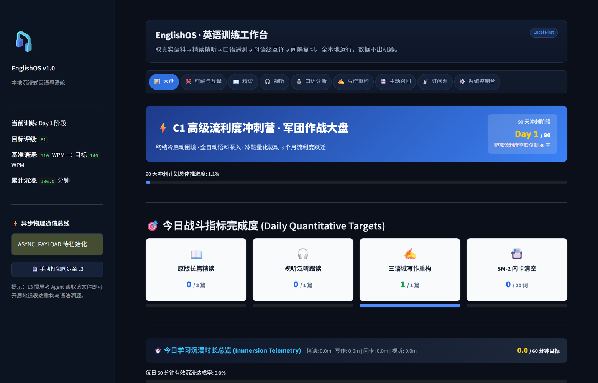
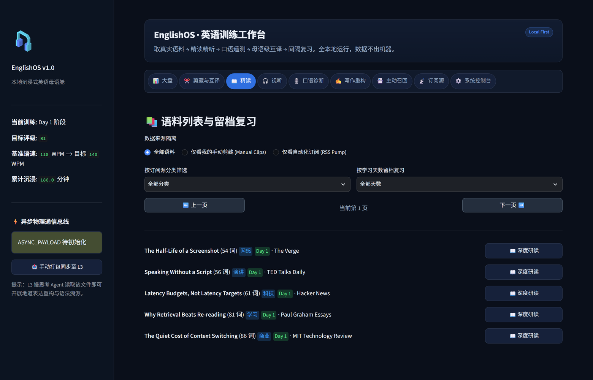
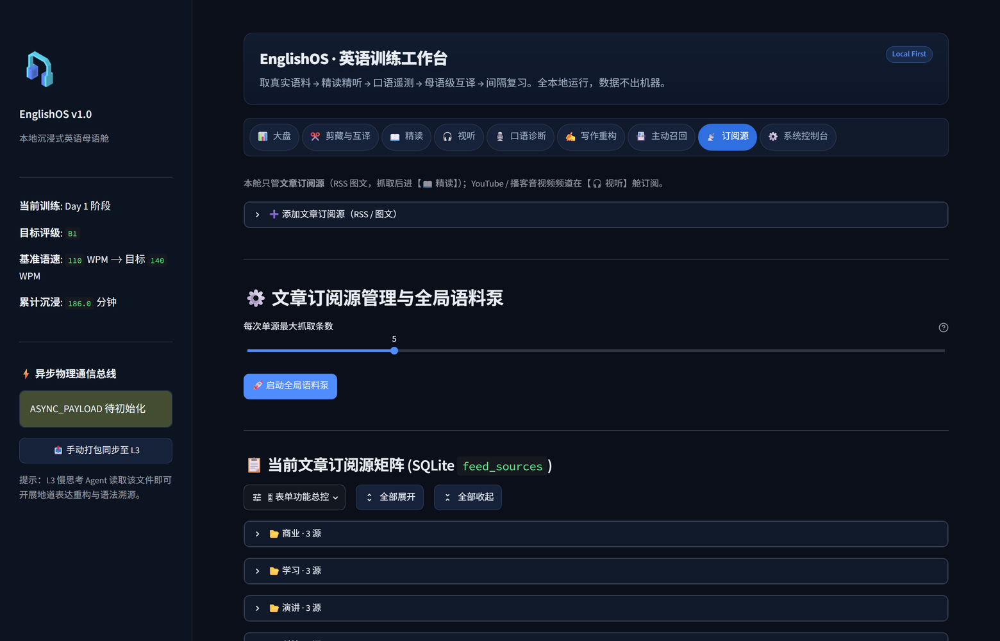

# EnglishOS

**本地优先的英语训练工作台。** 用真实外刊、播客与视频当语料，把「精读 → 精听 → 口语评测 → 写作重构 → 间隔复习」串成一条闭环，全流程在本机运行。

> 这里说明这个项目是什么、怎么设计、现在走到哪一步。源码暂未公开，项目持续开发中。



## 它解决什么问题

| 常见做法 | 问题 |
| :--- | :--- |
| 背单词 App | 脱离语境，记住了词也用不出来 |
| 教材精读 | 语料是编的，读完不会读真实文章 |
| 付费 AI 陪练 | 按次计费，且要把私人学习数据交给第三方 |
| 网课 | 输入多、输出少，没有可量化的反馈 |

EnglishOS 的取舍是：**语料必须是真实世界的，反馈必须是可量化的，数据必须不出本机。**

## 九个训练舱

| 舱位 | 做什么 |
| :--- | :--- |
| 大盘 | 今日四维进度、学习天数、频道矩阵与语料补给站 |
| 剪藏与互译 | 贴一个链接，取正文 → 人工确认 → 分段互译并归档入语料库 |
| 精读 | 外刊原文分级精读，逐句朗读、生词本、长难句拆解 |
| 视听 | 视频/播客切片，双语字幕对齐，影子跟读 |
| 口语诊断 | 端侧语音识别，输出语速、停顿、词级置信度热力图 |
| 写作重构 | 中式英语诊断，按三种语域（日常/商务/高管）重构 |
| 主动召回 | SuperMemo-2 间隔复习，靶向发音弱点 |
| 订阅源 | 信源矩阵管理，按频道分组，单源配额可控 |
| 系统控制台 | 模型接入、连接自检、引擎体检 |

## 界面

**语料列表与留档复习**——按频道分类与学习天数双维度筛选，分页器全舱只有一组。



**订阅源矩阵**——按频道分组折叠，单源抓取配额可控。



## 项目状态

个人项目，持续开发中。**尚无打包发行版**——目前以源码在本地运行，不提供下载安装包；更新按需发布，不跟版本号节奏。

**已经跑通并在日常使用**

九个训练舱的核心闭环、端侧语音识别与合成、媒体切片与字幕对齐、间隔复习调度、订阅源矩阵与语料补给。

**接下来要做的**

- **词汇训练**：现在是「语境里遇到的生词 + SM-2 复习」，缺一条主动强化的路径。计划加入打字式记忆练习，并补齐考试向词库（四六级、考研、雅思托福、专四专八、新概念、程序员英语）。
- **发版与启动**：现在靠脚本装环境、双击启动，换台机器就要重来一遍。要做成可分发的东西，降低部署成本。
- **语料侧稳定性**：抓取、切片、字幕的失败路径还要收得更干净。

## 架构

```
┌─────────────────────────────────────────────┐
│  表现层   Streamlit 九舱 · 统一设计系统       │
├─────────────────────────────────────────────┤
│  编排层   抓取 · 切片 · 打包 · 定时调度       │
├─────────────────────────────────────────────┤
│  能力层   语音识别 · 语音合成 · 媒体处理      │
│           互译 · 写作诊断 · 记忆调度          │
├─────────────────────────────────────────────┤
│  数据层   SQLite（WAL）· 单机单用户状态总线   │
└─────────────────────────────────────────────┘
```

几条硬约束：

- **数据层是唯一的事实来源。** 表现层不持有 SQL，取数一律走具名方法；这条边界由测试机械校验，退化了就红。
- **端侧能力不依赖付费 API。** 语音识别、语音合成、媒体切片全部本地完成；模型接入是可选增强，不是运行前提。
- **可选依赖不得拖垮主体。** 任何一个引擎的依赖缺失，只影响它自己，不影响其余模块加载。
- **失败必须显性。** 抓取失败就是失败，不塞假数据；未配置模型就明确报错，不做静默降级。

## 技术栈

Python 3.11 · Streamlit · SQLite（WAL）· Faster-Whisper · Edge-TTS · yt-dlp · FFmpeg · pandas · pytest

## 设计取舍

**为什么是单机单用户，不是 SaaS？**
学习数据是长期资产，也是最私人的一类数据。本地存储牺牲了多端同步，换来的是零运维成本和不用担心数据流向。

**为什么选 Streamlit？**
它的上限确实低——细粒度交互控制和前端性能都不如自建前端。但原型阶段的最大成本是「每改一次都要写一遍前后端」，Streamlit 把这条成本压到接近零。代价是状态管理要靠约定兜住，这部分我写成了显式契约并落到测试里。

**为什么模型接入是可选层？**
核心链路（识别、合成、切片、记忆调度）都能离线跑。模型只在互译与写作重构里用，且走 OpenAI 兼容协议——换供应商只改配置，不改代码。

**为什么坚持测试先行？**
这个系统里最容易腐烂的不是功能，而是边界：取数路径、降级路径、状态迁移。这些地方一旦静默失效，表现是「页面还在、数字错了」，靠肉眼永远发现不了。

## 隐私

- 学习记录、语料、登录态全部留在本机，不上传。
- 密钥只存在本地配置文件与环境变量里，不进版本库。
- 对外请求只发生在你主动触发抓取或调用模型时。

## 代码片段

`snippets/sm2.py` 是间隔复习调度中的纯函数实现——标准 SM-2 算法，无外部依赖。

## 许可

MIT
